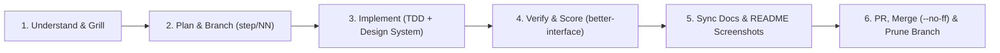

# Engineering Starter Repository

A portable, self-contained engineering operating system for software projects built with Antigravity and agentic coding assistants.

Clone this repository onto any machine and start building immediately with a complete suite of **267 offline UI/UX, Motion, Framework, Cloud & Data, and Engineering Workflow skills**, a pre-configured **Phosphor Iconography System** (`components.json`), ready-to-use **MCP templates**, and strict **Git & Documentation hygiene**.

---

## Product in Action (Visual Showcase Template)

> **Standing Rule for Projects Built From This Starter**:
> Every time `README.md` is created or updated for a project, **always include real product images or screenshots showing the product in action (`docs/assets/`) — every single time**, and update documentation on every pass and PR merge so docs are never stale.

---

## What Travels With This Repository

### 1. Portable Agent Skills Suite (`.agents/skills/`) — 267 Skills
No global machine setup required. All skills live inside `.agents/skills/` and work out of the box:
- **UI/UX Pro Max (`ui-ux-pro-max`)**: Local Python search engine (`scripts/search.py`) with 79 styles, 192 product palettes, 74 font pairings, 119 UX guidelines, 105 icons, 17 GSAP presets, and 22 technology stacks.
- **Design & Art Direction**:
  - `design-system` — Project token grounding + **Phosphor Icons** semantic weight hierarchy (`regular`, `duotone`, `bold`, `fill`).
  - `daybreak-design-skill` — Quiet, dense, type-driven editorial reader design system inspired by `brianlovin.com/hn` and Danish functionalism.
  - `logo-design` — Senior brand-mark & identity design system with SVG generator and audit tools.
  - `minimalist-ui` — Warm monochrome palettes, editorial serif/sans hierarchy, flat `1px` border bento architectures.
  - `tastemaker` (`codeswithroh`) & `taste-skill` (`leonxlnx`) — Anti-slop art direction, contrast-verified palettes, hallmark layouts.
  - `web-design-engineer` & `motion-showreel` (ConardLi Garden skills) — OKLCH color theory, style recipes, interactive showreels.
  - `landing-page-design` & `figma-designer` (Elaya Design) — Conversion-first offer strategy + visual system for landing pages.
  - `build-awwwards-quality-sites` & `design-first-ui-prompting` (Meng To) — Awwwards-tier scroll storytelling and UI specs.
  - `owl-*` (Owl-Listener Designer Toolkit) — Color systems, fluid typography scales, spacing grids, dark mode, micro-interactions, and Design QA checklists.
- **Site Quality Scoring & UI Testing (Jakub Krehel)**:
  - `better-interface` — Cross-discipline meta-audit that evaluates and scores how good a site is across UI, typography, color, layout, accessibility, and copy.
  - `better-ui`, `better-typography`, `better-colors`, `better-layout`, `better-accessibility`, `better-writing`, `interface-review`, and `break` (edge-case stress testing).
  - `browser-verification` — Real browser verification loop.
- **Motion & GSAP Engineering (Emil Kowalski, GreenSock & Transitions Agent)**:
  - `emil-design-eng`, `animate`, `review-animations`, `improve-animations`, `find-animation-opportunities`, `animation-performance`.
  - `transitions-agent` — Complete CLI motion scanner and recipe refactoring system.
  - Official GreenSock suite: `gsap-core`, `gsap-scrolltrigger`, `gsap-timeline`, `gsap-react`, `gsap-plugins`, `gsap-performance`, `gsap-frameworks`, `gsap-utils`, and `cinematic-gsap-lenis-motion-system`.
  - `motion` (Motion for React & Framer Motion with CSS spring calculators and audit guides).
- **Superpowers Engineering Loop**:
  - `using-superpowers` — Workflow harness and skill dispatching router.
  - `brainstorming` — Socratic product exploration, requirements shaping, and visual companion.
  - `writing-plans` & `executing-plans` — Granular technical design specs, bite-sized tasks, and execution gates.
  - `subagent-driven-development` & `dispatching-parallel-agents` — Worktree and subagent orchestrations.
  - `systematic-debugging` & `diagnosing-superpowers` — 4-phase root-cause diagnosis.
  - `test-driven-development` — Red-green-refactor cycle.
  - `verification-before-completion` — Strict proof and evidence before assertions.
  - `requesting-code-review` & `receiving-code-review` — Two-axis diff review and pushback handling.
  - `finishing-a-development-branch` & `using-git-worktrees` — Worktree management and merge protocols.
  - `writing-skills` — Skill authoring and benchmarking.
- **Framework & Application Ecosystems**:
  - **Flutter & Dart (25 skills)**: `flutter-build-responsive-layout`, `flutter-setup-declarative-routing`, `dart-add-unit-test`, `dart-collect-coverage`, `dart-generate-test-mocks`, `dart-run-static-analysis`, `dart-use-primary-constructors`, etc.
  - **Firebase (13 skills)**: `firebase_auth_basics`, `firebase_ai_logic_basics`, `firebase_firestore`, `firebase_crashlytics`, `firestore_rules_creation`, `firebase_security_rules_auditor`.
  - **Android & Mobile (3 skills)**: `android-cli`, `compose-preview`, `device-hub`.
  - **FastAPI & Python**: `fastapi` (official best practices & streaming), `uv`, `managing-python-dependencies`.
  - **Frontend UI Migrations**: `migrate-radix-to-base` (full 10-reference migration guide from Radix to Base UI), `pick-ui-library`, `shadcn`.
- **Cloud, BigQuery & Data Engineering (37 skills)**:
  - `bigquery-sql`, `bigquery-ai-ml`, `bigquery-bigframes`, `dataform-bigquery`, `dbt-bigquery`, `gcp-dataflow`, `gcp-managed-airflow`, `gcp-spark`, `data-autocleaning`.
- **Science & Bioinformatics (41 skills)**:
  - `alphafold`, `chembl`, `pdb`, `pymol`, `uniprot`, `pubchem`, `clinvar`, `literature-search-arxiv`, `europepmc`.
- **Chrome DevTools & MCP Documentation**:
  - `context7-mcp` — Context7 MCP resolution and documentation query engine.
  - `chrome-devtools`, `a11y-debugging`, `cookie-debugging`, `memory-leak-debugging`, `debug-optimize-lcp`, `troubleshooting`.
- **Engineering Alignment & Core Workflows**:
  - `ask-matt`, `grill-me`, `to-spec`, `to-tickets`, `triage`, `implement`, `tdd`, `code-review`, `diagnosing-bugs`, `prototype`, `domain-modeling`, `setup-matt-pocock-skills`, `research`, `using-ao`, `openai-docs`.

### 2. Baseline UI & MCP Configs
- **[`components.json`](./components.json)**: Pre-configured for `shadcn/ui` with Tailwind CSS variables and `"iconLibrary": "phosphor"` (`@phosphor-icons/react`).
- **[`.agents/mcp_config.json.example`](./.agents/mcp_config.json.example)**: Copy-paste ready configuration for `context7`, `shadcn`, `chrome-devtools`, `playwright`, `github`, and `neon`.

### 3. Disciplined Git & Verification Scripts (`scripts/`)
- **[`scripts/bootstrap.ps1`](./scripts/bootstrap.ps1)**: Inspects a newly cloned environment and reports toolchain readiness.
- **[`scripts/check-env.ps1`](./scripts/check-env.ps1)**: Quick health check for Git, Node, pnpm, Python, and uv.
- **[`scripts/verify.ps1`](./scripts/verify.ps1)**: Central verification runner checking git state, untracked secrets, `components.json`, skill frontmatter integrity, and project test suites.
- **[`scripts/git-cleanup.ps1`](./scripts/git-cleanup.ps1)**: Prunes merged local/remote `step/*` branches, stale remote tracking refs, and orphaned git worktrees.

---

## Starting a New Project From This Starter

1. Clone this repository into your new project directory.
2. Run `.\scripts\bootstrap.ps1` to verify local tooling.
3. Complete [`CONTEXT.md`](./CONTEXT.md) with your project domain, actors, constraints, and non-goals.
4. Review [`DESIGN.md`](./DESIGN.md) and customize project-specific color/font tokens while preserving the Phosphor Iconography System and motion rules.
5. Copy `.agents/mcp_config.json.example` to `.agents/mcp_config.json` if configuring project-specific MCP credentials.
6. Create `docs/steps/01-<slug>.md` from [`docs/steps/00-plan-template.md`](./docs/steps/00-plan-template.md) on a dedicated `step/01-<slug>` branch.
7. Build, verify in a live browser, capture product screenshots into `docs/assets/`, and replace this `README.md` with your product's living documentation.

---

## Core Documents

| Document | Purpose |
|---|---|
| [`AGENTS.md`](./AGENTS.md) | Authoritative agent working agreement, standing rules, and full skill index |
| [`BUILD_PROTOCOL.md`](./BUILD_PROTOCOL.md) | 10-stage development loop, post-merge branch pruning, and doc mandates |
| [`CONTEXT.md`](./CONTEXT.md) | Project domain, users, terminology, constraints, and non-goals |
| [`DESIGN.md`](./DESIGN.md) | Design philosophy, Phosphor Iconography System, typography, and motion rules |
| [`docs/agents/skills.md`](./docs/agents/skills.md) | Detailed reference for all 70+ local skills |
| [`docs/agents/mcps.md`](./docs/agents/mcps.md) | MCP server reference and setup guide |
| [`docs/agents/file-structure.md`](./docs/agents/file-structure.md) | Functional directory layout and file placement rules |
